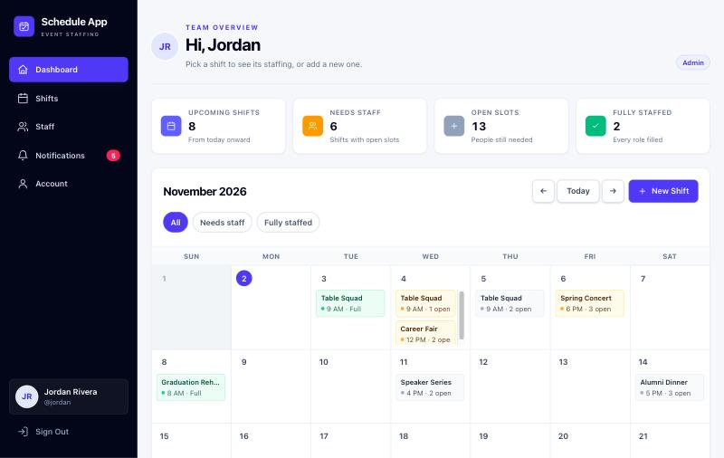
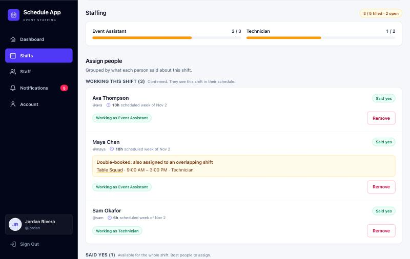
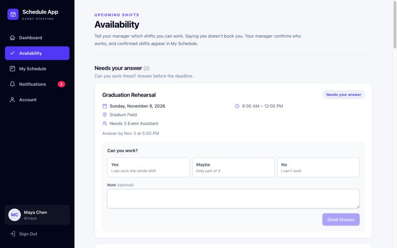
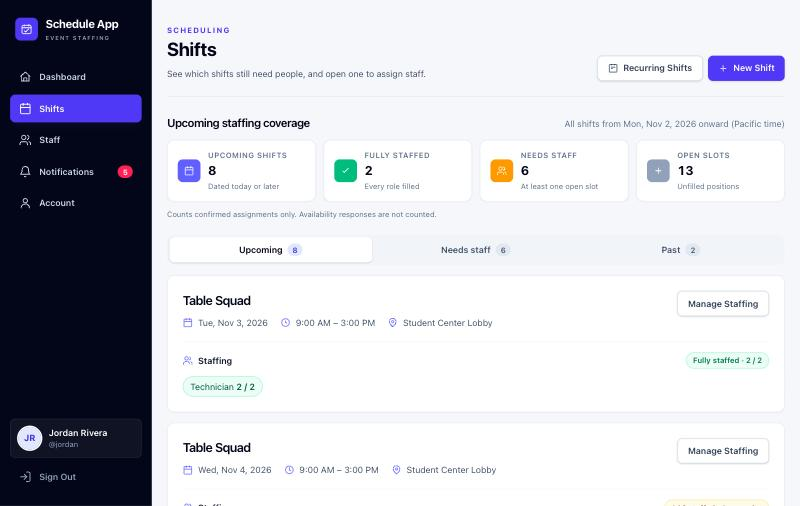
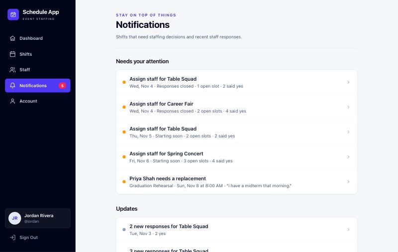
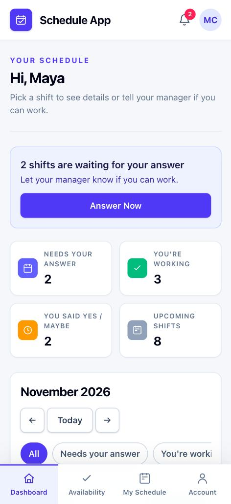

# Schedule App

[](https://github.com/krishadya/schedule-app/actions/workflows/ci.yml)

A self-hosted staff scheduling app for small event teams. Managers post shifts,
staff say whether they can work, and managers assign people to roles.
Everyone sees their confirmed schedule on a calendar.

Schedule App was first built for an events team at San Francisco State
University. You can run your own copy with your own free Supabase project.
Each installation is fully independent and serves one organization.



## Screenshots

| Assign people to a shift | Staff answer whether they can work |
| --- | --- |
|  |  |
| **See what still needs staff** | **Notifications for things that need action** |
|  |  |

<p align="center">
  
</p>

All screenshots use the demo data from `npm run seed:demo`.

## Features

**For managers (admins)**

- Create single shifts, recurring schedules (pick weekdays across a date range,
  preview before saving), or duplicate an existing shift.
- Set how many people each shift needs per role, e.g. Technician × 2.
- See who said yes, maybe, or no, and who hasn't answered.
- Assign staff to roles with capacity limits enforced.
- A staffing coverage overview shows upcoming, fully staffed, and short-staffed
  shifts, plus total open slots.
- Overlap warnings show when someone is already assigned to a shift at the
  same time.
- Scheduled hours are shown per person for this week and next.
- Notifications flag shifts that still need staff after responses close or
  shortly before they start.
- Review replacement requests. Approving removes that person's assignment
  so the slot can be filled again.
- Create staff accounts and reset passwords.

**For staff**

- Respond Yes, Maybe, or No to upcoming shifts, with optional notes and
  alternate times.
- See confirmed shifts on a calendar and in My Schedule, with weekly hours.
- Ask for a replacement when they can't make an assigned shift.
- Notifications for shifts awaiting a response, new assignments, and
  reminders for today and tomorrow.
- Change name, username, password, and profile picture.

Availability and assignments are separate. Saying "Yes" does not put
someone on the schedule. Only an admin's assignment does.

## Tech stack

Next.js 16 (App Router, Server Actions), React 19, TypeScript, Tailwind CSS 4,
and Supabase (Postgres, Auth, Storage, Row Level Security).

## Setup

### Prerequisites

- Node.js 20.9 or newer
- A free [Supabase](https://supabase.com) account

### 1. Create a Supabase project

Create a new project in the Supabase dashboard. Under **Project Settings → API**
copy the Project URL, the `anon` public key, and the `service_role` key.

### 2. Create the database

Open **SQL Editor** in the Supabase dashboard and run each file in
`supabase/migrations/` **in filename order**, one at a time:

1. `20260930000000_initial_schema.sql`: tables, row level security, roles
2. `20260930130000_add_profile_usernames.sql`: usernames
3. `20261014120000_profile_customization.sql`: profile editing and the
   `avatars` storage bucket
4. `20261026170000_create_recurring_shifts_rpc.sql`: atomic recurring shift
   creation
5. `20261101120000_replacement_requests.sql`: shift replacement requests

### 3. Configure environment variables

```bash
cp .env.example .env.local
```

Fill in `.env.local`:

```env
NEXT_PUBLIC_SUPABASE_URL=https://your-project-ref.supabase.co
NEXT_PUBLIC_SUPABASE_ANON_KEY=your-anon-public-key
SUPABASE_SERVICE_ROLE_KEY=your-service-role-key
```

The service-role key is only used on the server, to create staff accounts and
reset passwords. Never prefix it with `NEXT_PUBLIC_` or commit `.env.local`.

### 4. Install and run

```bash
npm install
npm run dev
```

Open http://localhost:3000.

### 5. Create the first admin

There is no public sign-up. Staff accounts are created by an admin, so the
first admin is created by hand:

1. In Supabase go to **Authentication → Users → Add user → Create new user**.
2. Email: `yourname@schedule.local` (see the note below), choose a password, and
   check **Auto Confirm User**.
3. In **SQL Editor**, promote that account:

   ```sql
   update public.profiles
   set role = 'admin', full_name = 'Your Name'
   where username = 'yourname';
   ```

4. Sign in to the app with username `yourname` and your password. Then add
   staff from the **Staff** page.

**Note on usernames:** people sign in with a username, not an email.
Internally each username maps to a placeholder email `username@schedule.local`
in Supabase Auth. These addresses never receive mail. That's why
notifications are in-app.

### 6. Try it with demo data (optional)

To explore the app without real people, create a **separate, empty** Supabase
project, run the migrations there, and put its URL and keys in `.env.demo`
(same three variables). Then:

```bash
npm run seed:demo
```

This adds an admin (`jordan`), six staff members, and a few weeks of shifts with
answers, assignments, an overlapping booking, and a replacement request. The
shared password is written to `.env.demo-accounts`. The script refuses to run
on a project that already has people or shifts.

Run the app against the demo project with:

```bash
env $(grep -v '^#' .env.demo | xargs) npm run dev
```

## Configuration

- **Time zone:** dates and deadlines use `America/Los_Angeles`. Change
  `APP_TIME_ZONE` in `lib/date.ts` for a different region.

## Deploying

Any Node host that supports Next.js works. On [Vercel](https://vercel.com),
import the repository and add the three environment variables above in the
project settings.

## Development

```bash
npm run lint    # ESLint
npm run build   # production build and type check
npm test        # unit tests (node:test)
```

Project layout:

- `app/`: routes. `admin/` holds manager pages; `shifts/`, `schedule/`,
  `dashboard/`, `notifications/` and `account/` are for everyone.
- `lib/`: data loading and pure helpers (coverage, conflicts, hours,
  recurrence, notifications).
- `components/`: shared layout and UI pieces.
- `supabase/migrations/`: the full database schema.
- `scripts/seed-demo.mjs`: optional demo data for an empty project.
- `tests/`: unit tests.

## Security

- Every table uses Postgres row level security. Staff can only read and change
  their own responses and profile. Only admins can manage shifts and
  assignments.
- Normal scheduling uses the signed-in user's session. The service-role key is
  used only on the server for account administration.

## License

[MIT](LICENSE)
